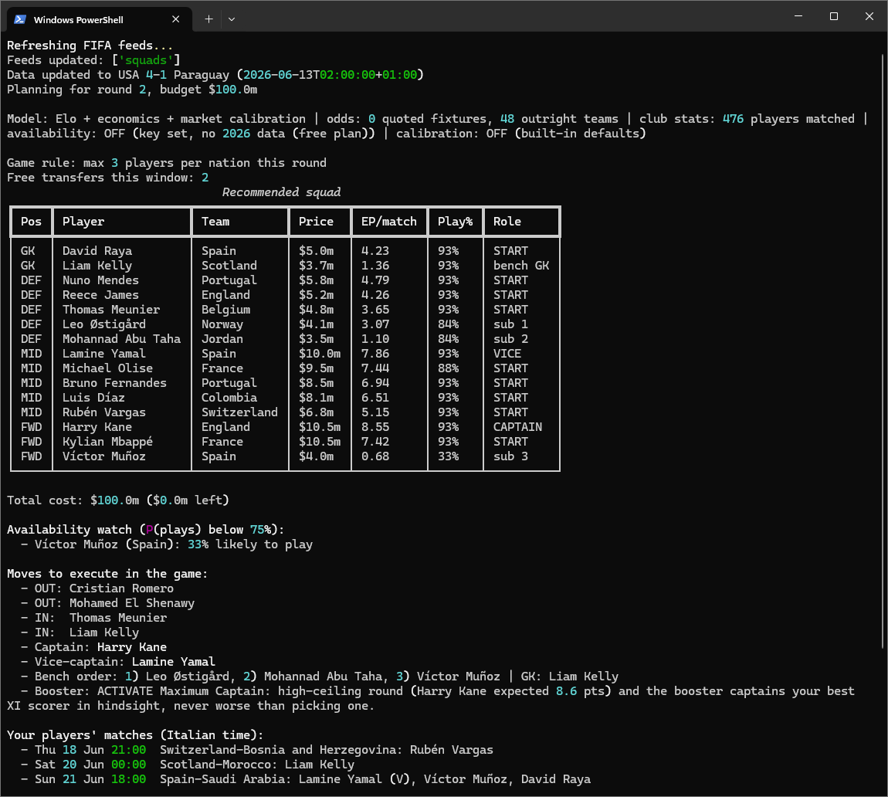

# worldcup-fantasy

**An advisor that helps you play the game of FIFA Fantasy of the FIFA World Cup 2026.**


Run one command each round and it tells you the transfers, lineup, captain and boosters
to set in the game. It downloads the FIFA fantasy feeds updated to the last played match,
estimates every player's expected points, simulates the rest of the tournament, and
prints the moves to make by hand. It never logs into your FIFA account.

## How it decides

- **Expected points:** each player's 2025/26 club stats (FBref) run through the official
  scoring table, blended with the fantasy price and his live World Cup form.
- **Who starts:** the game's own prices encode a depth chart; injuries and confirmed
  lineups discount it when an API key is set.
- **How far the team goes:** Elo over ~49k internationals plus a Monte Carlo of the
  official bracket, calibrated with bookmaker odds. Players from likely finalists are
  worth more.
- **The squad:** an ILP (integer linear program) picks the 15 that maximize points under
  the budget, position quotas, per-country caps and legal formations.
- **Live:** after each match it advises captain swaps and substitutions, pricing in the
  auto-sub insurance you forfeit with the first manual change.

## Quickstart

```powershell
python -m venv .venv
.\.venv\Scripts\Activate.ps1
pip install -e . -r requirements.txt
python -m wcfantasy advise
```

The first run downloads and caches everything it needs into `data/`. Add a free
[The Odds API](https://the-odds-api.com) or [API-Football](https://www.api-football.com)
key for odds and injuries; without them it runs on the feeds and Elo alone.

## Commands

All commands are `python -m wcfantasy <command>`.

| Command | What it does |
| --- | --- |
| `advise` | Refresh data and print the full plan for the next round |
| `live` | Captain switch and substitution advice during a round |
| `live --mark-changed` | Record a manual change you made in-game |
| `team apply` | Record the advised moves as executed |
| `team show` | Show your saved squad |
| `team use-booster <name>` | Mark a booster as used |
| `calibrate` | Refit the priors against real results (`--write` to persist) |
| `fetch` | Refresh the FIFA feeds only |

## Data sources

FIFA fantasy feeds (players, prices, fixtures, scores), [FBref](https://fbref.com) club
stats via `soccerdata`, [martj42 international results](https://github.com/martj42/international_results)
for the Elo ratings, [The Odds API](https://the-odds-api.com),
[API-Football](https://www.api-football.com) and World Bank economics. Everything except
the FIFA feeds is optional.

## Notes

Semi-automatic: it reads public data and prints instructions; you make the moves in the
game. Prices are fixed all tournament, so price is a quality signal and a budget cost,
never a market. Unofficial, not affiliated with FIFA.

## Example output

`python -m wcfantasy advise` prints the recommended squad and the moves to make:


